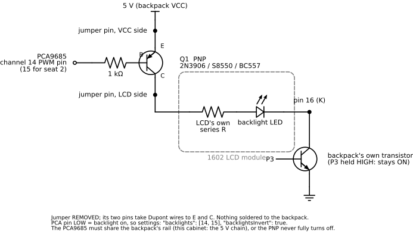
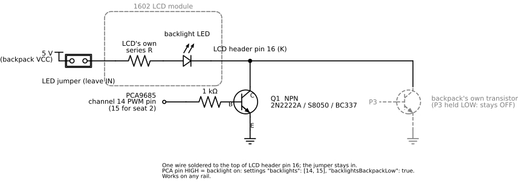

# Hardware PWM (PCA9685)

The button lamps dim either way. Without extra hardware the MCP23017 expander
bit-angle-modulates them from the Pi: a 100 Hz frame split into slots, every
level a bit pattern, and the I2C bus busy for as long as anything is mid-fade.
It works, but the resolution is what the write budget affords, the 100 Hz
frame is visible as a faint flicker to some eyes, and a heavily loaded Pi can
wobble a slot boundary into a worse one. The LCD backlights are modulated the
same way by their backpacks' single backlight bit.

A PCA9685 takes the modulation off the CPU: 16 channels of 12-bit PWM at a
frequency of its own, driven by a 25 MHz oscillator, updated with one 5-byte
write per lamp and then left alone. Levels are gamma-corrected (2.2) on the
way in, so a fade reads as linear to the eye rather than snapping to full in
the first quarter.

The board is optional and auto-detected. Nothing needs configuring to add or
remove it.

## The board

The supported module is the common Adafruit-style PCA9685 breakout (sold under
many names):

- 16 three-pin headers in groups of four, each column **PWM / V+ / GND** from
  the board's edge inward.
- A 220 Ω series resistor on every PWM pin.
- A screw terminal and a header pin for **V+**, the servo supply rail
  (5–10 V on the terminal; the header side is rated to 6 V). The lamps never
  use it.
- **VCC** is the chip's own logic supply and sets the output HIGH level.
- **OE** (output enable, active low) is pulled low on the board, so outputs
  are enabled with the pin left alone.
- Address jumpers A0–A5, all open = 0x40.
- Outputs are active-high totem-pole by default (INVRT off): the duty is the
  HIGH time, exactly the polarity the expander pin drove.

## Wiring

- **Logic**: VCC to the rail the expander already uses, normally the 5 V
  chain (VCC, GND, SDA, SCL) that also feeds the driver boards and the LCD
  backpacks. The PCA's output HIGH is its VCC, so matching the expander keeps
  the drive the lamp stage was designed for, and matching the backpacks is
  what lets a single PNP switch a backlight (see the appendix). The
  datasheet's I2C input threshold at 5 V (3.5 V) is above the Pi's 3.3 V bus;
  in practice the chip probes and drives fine on it. GND common with the Pi.
- **Bus**: SDA/SCL to Pi I2C bus 1, in parallel with the LCD backpacks and
  the expander. Leave the address jumpers open unless something else already
  answers at 0x40. The chip also answers the All-Call address 0x70 out of
  reset — the driver clears that bit at init so a second board stays
  addressable.
- **V+**: leave the screw terminal and every header's middle pin empty. The
  lamps have their own supply through the driver stage; the PCA only sends
  the signal.
- **Lamps**: seat 1's six buttons to the PWM pins of channels 0–5, seat 2's
  to channels 8–13, in `hardware.LightButtons` order (joya, joyb, joyc, joyd,
  joyaux1, joyaux2). Each wire simply moves from its expander pin to its
  channel's PWM pin: the PWM pin delivers the same high (its VCC, the rail
  the expander was on) and the same class of current, and the board's 220 Ω
  sits in series with whatever base or gate resistor the driver stage
  already has.
- **Backlights** (optional, a small backpack modification — see
  [the appendix](#appendix-backlight-transistor-mod)): two
  more channels, conventionally 14 and 15.
- **Fan**: the relay input sits on the expander's port A bit 7 by default, so
  the MCP23017 is still required and the PCA only takes over the lamp pins,
  which stay latched low. One free PCA channel can carry it instead — see
  "Moving the fan" below, after which the expander board can come out.

## Settings

`data/hardware/settings.json`, all fields optional:

```json
{
  "pca9685": {
    "enabled": true,
    "addr": 64,
    "frequencyHz": 1000,
    "invert": false,
    "lamps": [[0, 1, 2, 3, 4, 5], [8, 9, 10, 11, 12, 13]],
    "backlights": [-1, -1],
    "backlightsInvert": false,
    "backlightsBackpackLow": false
  },
  "fan": {
    "expanderPins": [7],
    "pcaChannels": [],
    "invert": false
  }
}
```

Those are the defaults, which is also what a cabinet with no file at all gets.
`addr` is decimal (64 = 0x40). A channel of `-1` is "not wired to the PCA" —
that is what leaves the backlights on their backpacks by default. `invert`
sets MODE2's INVRT for the whole chip, for an active-low driver stage (a
sinking transistor array) where full brightness is a low output.
`backlightsInvert` mirrors only the backlight channels, for wiring where a
low output lights the backlight; the lamps are untouched by it.
`backlightsBackpackLow` holds the backpack's own backlight bit LOW instead of
HIGH while the PCA owns the backlight — required by the low-side wiring in
the appendix, where an external transistor replaces the backpack's.

`enabled: false` skips the probe entirely and pins the cabinet to the
expander.

The `fan` block is read the same way, and every field in it is optional too.
It is described under "Moving the fan" below.

## Which driver is running

Two lines at boot say so, before anything else touches the lamps:

```text
lamps: PCA9685 at 0x40, 1000 Hz
fan: MCP23017 port A pins 7
hardware: lamp driver pca9685, fan driver mcp23017
```

or, with no board on the bus:

```text
lamps: MCP23017 bit-angle (no PCA9685 at 0x40)
fan: MCP23017 port A pins 7
hardware: lamp driver mcp23017, fan driver mcp23017
```

The probe is a MODE1 read: a NACK means absent, and the fallback is silent
apart from that line. `Suite.LampDriver()` and `Suite.FanDriver()` report the
same strings to diagnostics screens.

## Adding the board

1. Power the cabinet down and mount the board where the lamp signal wires
   reach. Keep the expander board: the I2C chain runs through it to the driver
   boards and LCD backpacks, and the fan relay is on it until "Moving the fan"
   says otherwise.
2. Give the PCA the bus: VCC, GND, SDA, SCL from anywhere on the chain. The
   two side headers carry the same six nets in parallel (GND, OE, SCL, SDA,
   VCC, V+), so either side is an input. Leave V+ and OE unconnected.
3. Move each lamp signal wire from its expander pin to the PWM pin of its
   channel: PA0-PA5 to channels 0-5, PB0-PB5 to channels 8-13. Use the PWM
   row only; the fan wire stays on the expander.
4. Power up. `i2cdetect -y 1` should list `40` beside the expander and the
   backpacks, and `journalctl -u arkade -b | grep "lamp driver"` should say
   `pca9685`.
5. Check polarity with the BRIGHT tile: LAMPS OFF must be dark, LAMPS ON full.
   Backwards means the driver stage is active-low: set `"invert": true` and
   restart the service.
6. Watch a fade. It should be smooth and free of the 100 Hz shimmer. If a lamp
   at a low level goes fully dark, its driver is too slow for a 1 kHz pulse:
   lower `frequencyHz` (200 Hz gives a slow transistor more time per pulse)
   before suspecting the wiring.

Pulling the board, or `"enabled": false`, puts the cabinet back on the
expander with no other change.

## Moving the fan

The fan relay is the last thing holding the expander in the cabinet. Its
input is a logic level, not a brightness: the coil is either driven or it is
not, and anything in between chatters it. So a PCA channel carries it as a
static output — full-on or full-off, set once per transition, never a duty and
never a fade. That is all the expander pin ever did.

1. Power the cabinet down. Move the relay's input wire from the expander's
   port A pin 7 to the PWM pin of a free channel — 7 is the obvious one on a
   cabinet using 0–5 and 8–13 for lamps, and it leaves 14 and 15 for the
   backlights. The relay module's own VCC and GND stay where they are; only
   the signal moves.
2. Settings: `"fan": { "pcaChannels": [7] }`, then restart. Channels win over
   `expanderPins` whenever the board answered its probe, so the expander entry
   can stay in the file as the fallback.
3. Check the boot log: `fan: PCA9685 channels 7 (inverted=false)` and
   `fan driver pca9685`.
4. Check the relay. The config app's fan screen has an ON mode that engages it
   regardless of temperature, which is the quickest test; OFF pins it down and
   AUTO hands it back to the threshold.

If the relay is engaged when it should be idle, the module is one of the
active-low boards: set `"invert": true` in the same block and restart. That
flips only the fan's channels — the lamps' `pca9685.invert` is separate.

One relay input drives both fans, so one channel is enough. `pcaChannels` and `expanderPins` are lists anyway, for wiring with a
second relay; a second entry is written the same value at the same moment and
simply mirrors the first.

Once the lamps AND the fan are on the PCA, nothing addresses 0x26 any more and
the expander board can come out. **The bus chain passes through it**: VCC,
GND, SDA and SCL arrive on one side and leave on the other to the driver
boards and the LCD backpacks. Re-join those four nets where the board was —
splice them, or move the onward cable onto the PCA's spare side header — or
everything downstream of the gap goes quiet. `i2cdetect -y 1` should then list
`23`, `27` and `40`, with `26` gone and nothing else missing. The boot log
says the same in words:

```text
no MCP23017 at 0x26: the PCA9685 has the lamps and the fan
```

That line is informational. With the fan still on the expander a missing 0x26
is an error, and the fan quietly becomes a no-op rather than
taking the cabinet down with it.

## LCD backlights at power-on

The PCF8574 powers up with every pin high, so a backpack's backlight is lit
from power-on until software takes it over; no software can change that reset
state. `scripts/arkade-lcdboot.service` (see
[Cabinet](CABINET.md#lcdboot)) shortens the gap by darkening the backlights
a few seconds into boot.

Channel write order matters for a PCA-driven backlight. A `backlightsInvert`
channel is lit while its output is LOW, and the PCA9685's reset leaves every
channel full-OFF, which is LOW, so an inverted backlight comes up at its lit
end. `pi.Suite.initPWM` and the lcdboot tool therefore drive the backlight
channels dark immediately after the probe, before either LCD is woken, and
`SetBacklightLevel` always writes the channel before the backpack's gate bit.
The wrong order leaves both panels at full until the next write lands.

## Appendix: backlight transistor mod

The backpack's backlight is one PCF8574 pin (P3) driving a small transistor
that switches the LCD's backlight LED; a two-pin "LED" jumper on the backpack
sits in the LED's supply. The software modulation flickers because the pin
can only be toggled between text writes. Putting the backlight on a PCA
channel makes it 12-bit hardware PWM like the lamps, and it also fixes the
power-on glare: PCA outputs come up OFF at reset, whereas the PCF8574's pins
come up HIGH (see "LCD backlights at power-on").

A PCA pin cannot run the backlight by itself: it is a logic output through
the board's 220 Ω, and the LED wants tens of milliamps from the backpack's
rail.
Every option below puts one transistor between them. The LED path on the
backpack is VCC → LED jumper → the LCD's own series resistor → LED anode
(header pin 15) → cathode (header pin 16) → the backpack's transistor →
ground, with P3 switching that transistor.

**The PCA and the backpacks must share a rail for figure A.** A PNP with its emitter on the backpack rail only turns
fully off when its base can be driven up to that same voltage, which is the
PCA's own VCC. Confirm with a meter (DC volts, black lead on ground): with
the jumper pulled, the jumper pin that reads the rail is the VCC side, and
the PCA's VCC pin should read the same. Same rail → figure A, the no-solder
option. PCA on a lower rail than the backpacks → move its VCC wire, or use
figure B, or the two-transistor version at the end of this section.

Parts, per backpack, either figure: one small transistor, one 1 kΩ resistor,
a few Dupont wires. Two backpacks, so two of everything; channel 14 for seat
1's LCD, channel 15 for seat 2's. Base is the
middle leg on every part listed; the outer two swap between families, so
read the part in hand and hold its flat face toward you, legs down:

| Part | Type | Legs, left to right |
| --- | --- | --- |
| 2N3906, S8550 | PNP | Emitter, Base, Collector |
| BC557, BC327 | PNP | Collector, Base, Emitter |
| 2N2222A, PN2222A, S8050 | NPN | Emitter, Base, Collector |
| BC337, BC547 | NPN | Collector, Base, Emitter |

### Figure A — a PNP on the jumper pins (nothing soldered to the backpack)



The jumper comes out and its two pins become the transistor's emitter and
collector, so the transistor takes the jumper's place in the LED supply. The
backpack's own transistor stays in the path and stays on (P3 held high, the
default).

1. Pull the LED jumper. Meter the two pins: the one at the rail
   is the VCC side.
2. Dupont wire from the VCC-side pin to the **emitter**.
3. Dupont wire from the LCD-side pin to the **collector**.
4. 1 kΩ from the **base** to the PCA channel's PWM pin.
5. Insulate the legs; nothing else changes.
6. Settings: `"backlights": [14, 15]` and `"backlightsInvert": true` (a PNP
   conducts when its base is pulled low, so a LOW output is "on"), then
   restart.

One consequence of the inverted sense: a PCA channel is LOW at chip reset,
which turns the PNP on, so the backlight is lit from power-on until the
driver initialises, and the lcdboot tool cannot reach it earlier. A 10 kΩ pull-up from the base to the rail holds the PNP off until
the PCA drives the pin, and costs nothing else.

Meter check with the service running at LAMPS ON: emitter at the rail, base
about 0.7 V below it, collector within a few tenths of a volt of the
emitter. Base at the rail with the backlight on means the transistor is in
backwards (see the legs table). At LAMPS OFF the base should read the rail
and the backlight must be fully dark; a faint glow means the PCA's VCC is
below the backpack rail.

### Figure B — an NPN on the LCD cathode (any rail, one soldered wire)



Switching the ground side works whatever rail the PCA or the backpack is on.
The external transistor takes the backpack transistor's place, so the
backpack's bit is held LOW.

1. Solder the 1 kΩ to the **base**; its other end goes to the PCA channel's
   PWM pin.
2. Solder a wire from the **collector** to the top of LCD header pin 16, the
   last pin of the sixteen where the backpack is soldered to the LCD (marked
   K or 16 on the LCD's silkscreen). Nothing is cut.
3. **Emitter** to ground: the GND row of any PCA header column is the
   nearest point, or the backpack's GND pin.
4. Leave the LED jumper in. Insulate the legs.
5. Settings: `"backlights": [14, 15]` and `"backlightsBackpackLow": true`,
   then restart. PCA high = backlight on, so no inversion.

Meter check at LAMPS ON: base about 0.7 V above the emitter, collector near
0 V. Base at the rail with the collector still high means emitter and collector
are swapped.

### Figure A when the PCA is on a lower rail than the backpacks

Only if the PCA's VCC cannot be moved onto the backpack rail and soldering
to pin 16 is unwelcome. A level shift lets the PNP turn fully off:

```text
PCA pin ── 1 kΩ ── base of NPN (2N2222), emitter to ground
NPN collector ── 1 kΩ ── base of PNP (2N3906 / S8550)
PNP base ── 10 kΩ ── 5 V                   (fully off when the NPN is off)
PNP emitter ── 5 V (the VCC-side jumper pin, jumper removed)
PNP collector ── the LCD-side jumper pin
```

PCA high = backlight on here (the NPN inverts the PNP's sense), so no
inversion flag, and `backlightsBackpackLow` stays false.

The figures are generated by `figures/backlight_schematic.py` (schemdraw);
edit and re-run it rather than the SVGs.
