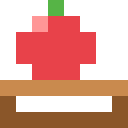

# Catcher

Fruit falls. You stand under it.

One player, one screen, three lives, and a score that goes on the
cabinet's board. A run opens with four set-piece waves and then never
stops, and it gets faster every time you catch something.

## How to play

Push the stick **left** and **right** to walk. The open basket is the
top of your sprite — put it under a falling fruit and it is yours, worth
ten points.

Anything that reaches the ground costs you a life. Three lost lives and
the run is over.

## The dash

Sometimes a fruit falls somewhere you simply cannot walk to in time.
That is what the **blue** button is for: a short burst of speed, roughly
two and a half times as fast, and then a second and a half before you
can do it again.

The blue lamp tells you when it is available. If it is dark, pressing it
does nothing but ring the "not now" bell — the light is the whole
answer, so play off it rather than counting seconds.

## The waves

A run starts with four waves that are the same every time: **FIRST
DROPS**, **DOUBLES**, **THE ZIGZAG** and **DOWNPOUR**. Each one announces
itself across the panel as it begins, and each one is built so that
every single fruit in it can be reached on foot — if you miss one, it was
gettable.

Take a whole wave and you get a **twenty-five point bonus** on top of the
catches. Miss one fruit and the bonus is gone, so the waves are worth
learning: they are identical every run, which is the point of them.

After DOWNPOUR the fruit stop being arranged and start being random, and
from there the game simply keeps going until you run out of lives. That
endless stretch is where a big score comes from; the waves are where you
warm up and bank a little.

## Getting faster

Each wave has its own pace, and they climb: DOWNPOUR drops a fruit every
quarter of a second. Once the waves are behind you, difficulty tracks
catches rather than time — every fruit you bring in makes the next ones
fall a little quicker and arrive a little closer together, until it
settles at a pace that is quite a lot to keep up with. Standing still and
letting fruit drop keeps the game slow, but also ends it.

## Your readout

The panel carries the essentials: score at the top left, remaining lives
as red pips at the top right, and a short bar under the score that fills
back up as the dash recharges.

The little screen at your seat carries the same score and lives in
words, so you can check them without taking your eyes off a fruit.

## Scoring

Ten points per catch, plus twenty-five for taking a whole wave. There is
no combo and no penalty beyond losing the run. A score in the top ten
asks for your initials; the seat remembers what you entered last time and
offers it back, so a returning regular confirms with one press.

## Leaving

The **red** button opens the quit prompt. Hold it for about a second to
confirm; let go and nothing happens. It works from anywhere, including
over the initials screen — where a placement you have not submitted yet
is exactly what the prompt is protecting.

---

*Manual for version 1.2.0*
